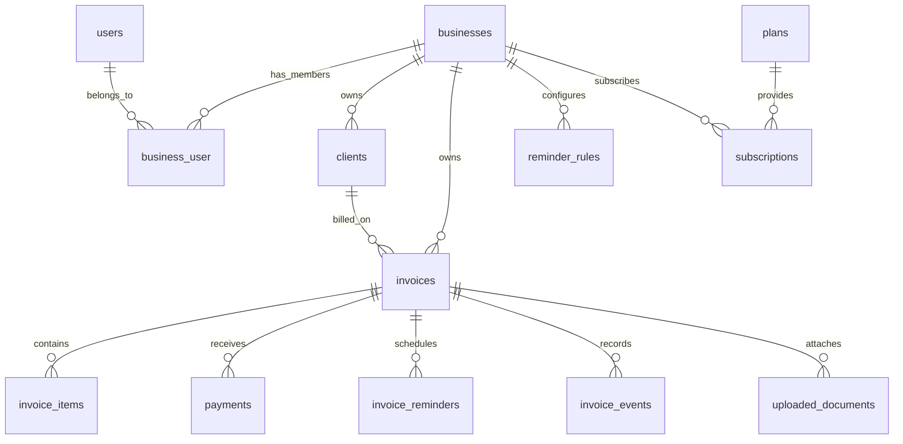

# PayMe data and API design

PayMe is scoped by business. Each signed-in user belongs to a business through
`business_user`; all API queries begin with that membership and never accept a
business ID from the browser. A new registration creates a business, while an
existing account receives one on its first authenticated API request.

## Entity relationships

The migration also creates Laravel's standard `notifications` table. Public
invoice URLs can later use the unique UUID `public_token`; internal IDs are not
intended for public invoice links. Uploaded files use the private `local` disk.

Amounts are integer minor units. `800.50 EUR` is stored as `80050`; the invoice
total and balance are kept on the invoice for bounded dashboard queries, while
individual payments remain the ledger. A payment updates both in one locked
transaction. Currency is fixed per invoice. The current dashboard totals only
the business's default currency to avoid adding unlike currencies.

## Indexes and query patterns

| Query | Supporting index |
| --- | --- |
| Invoice number lookup within a business | `UNIQUE (business_id, invoice_number)` |
| Outstanding and overdue totals, attention list | `(business_id, status, due_date)` |
| Recent invoices and cursor pagination | `(business_id, id)` |
| Status filtered invoice history | `(business_id, status, created_at)` |
| Client invoice history | `(business_id, client_id, created_at)` |
| Collected this month | `payments (business_id, paid_at)` |
| Reminder scheduler | `invoice_reminders (status, scheduled_at)` |
| Tenant reminder lists | `invoice_reminders (business_id, status, scheduled_at)` |
| Event timeline | `invoice_events (invoice_id, occurred_at)` |
| Staged upload queue | `uploaded_documents (business_id, status, created_at)` |

The dashboard fetches at most 20 attention and 20 recent invoices and eagerly
loads their client, first item description, and scheduled reminders. Invoice
and client list endpoints use cursor pagination. Index choices should be
rechecked with `EXPLAIN` against production-sized data and the chosen database
engine; extra indexes increase write cost.

## Authenticated JSON API

These `/api/*` endpoints currently use the existing Laravel session, verified
email middleware, CSRF protection, and a rate limit. A separate token API can
be added later without changing the domain services.

| Method | Endpoint | Purpose |
| --- | --- | --- |
| GET | `/api/dashboard` | Currency-safe metrics and bounded dashboard rows |
| GET / POST | `/api/clients` | Cursor-paginated list / create client |
| GET / PATCH / DELETE | `/api/clients/{client}` | Tenant-scoped client detail, update, delete (only without invoices) |
| GET / POST | `/api/invoices` | Cursor-paginated filtered list / create draft |
| GET | `/api/invoices/{invoice}` | Tenant-scoped invoice detail |
| PATCH | `/api/invoices/{invoice}/send` | Mark a draft as sent and start tracking |
| POST | `/api/invoices/{invoice}/payments` | Record a payment; empty body pays the full balance |
| PATCH | `/api/invoices/{invoice}/reminders` | Enable or pause reminders for a sent invoice |
| GET | `/api/reminders` | Cursor-paginated reminder activity |
| PATCH | `/api/reminders/{reminder}/skip` | Skip a pending reminder |
| GET / PATCH | `/api/reminder-rules[/{rule}]` | Read and edit reminder steps |
| GET | `/api/analytics` | Currency-safe collection totals, six-month payments, aging buckets |
| POST | `/api/uploaded-documents` | Stage a private PDF, JPEG, or PNG for confirmation |

`InvoiceResource` and `ClientResource` define the JSON contract. Validation
returns 422 errors. Invoice and payment writes use transactions; requests for
another business's invoice return 404.

## State and next implementation steps

Invoice state is `draft → sent → paid`; `cancelled` is reserved in the schema.
`due_soon` and `overdue` are computed from `sent` plus the due date. A full
payment cancels both scheduled and queued reminders immediately and disables
further reminders on the invoice. Partial payments remain supported by the
ledger and balance columns.

The Invoices, Clients, Reminders, and Analytics sidebar pages use these APIs.
Reminder rule editing, per-invoice scheduling, pausing, and skipping are live;
scheduled records are not emailed until a delivery worker is implemented.
The reminder queue records, event log, document staging, plans, and subscriptions
have schema now. Actual queued delivery, uploaded
document confirmation/extraction, PDF/public invoice delivery, and subscription
enforcement are not activated by this data/API phase. Before delivery is
enabled, a queued job must lock and check the invoice immediately before send
so a late payment cannot result in another reminder.
